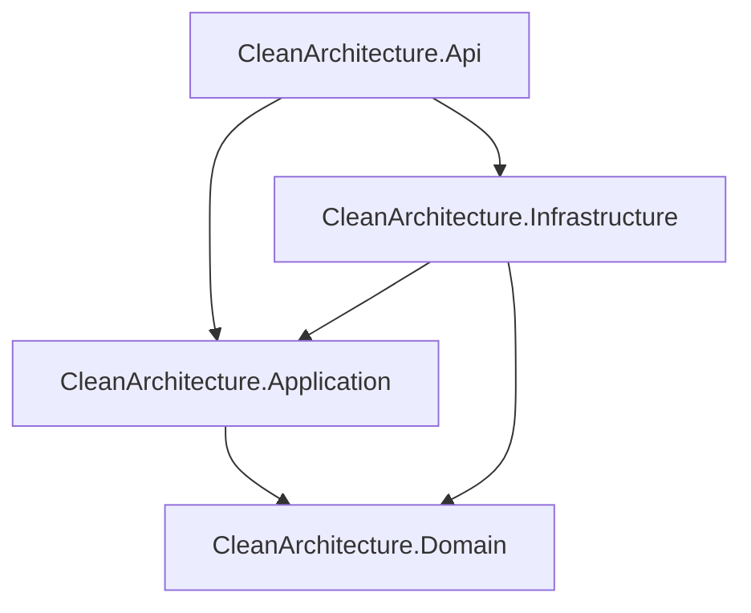
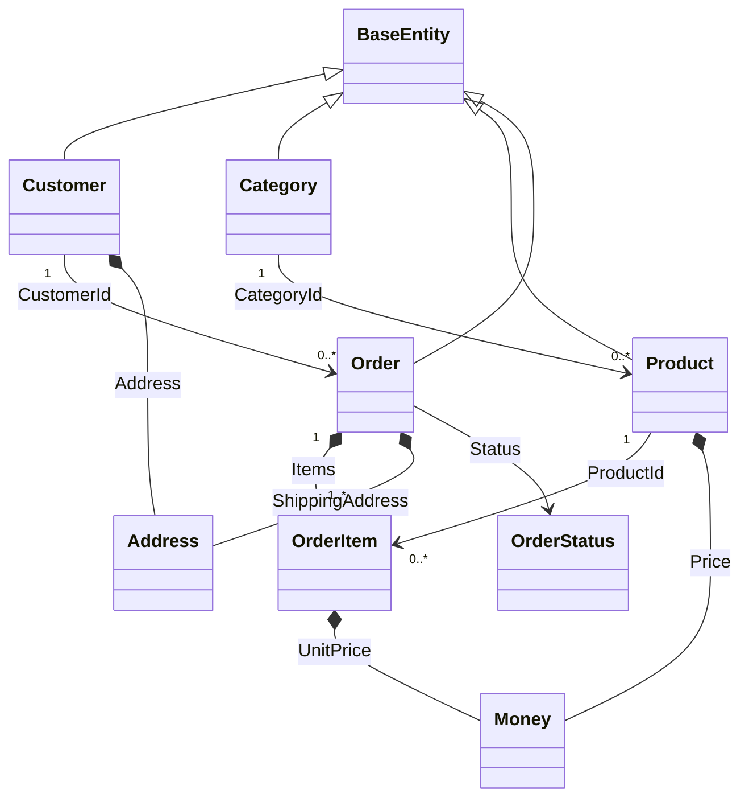
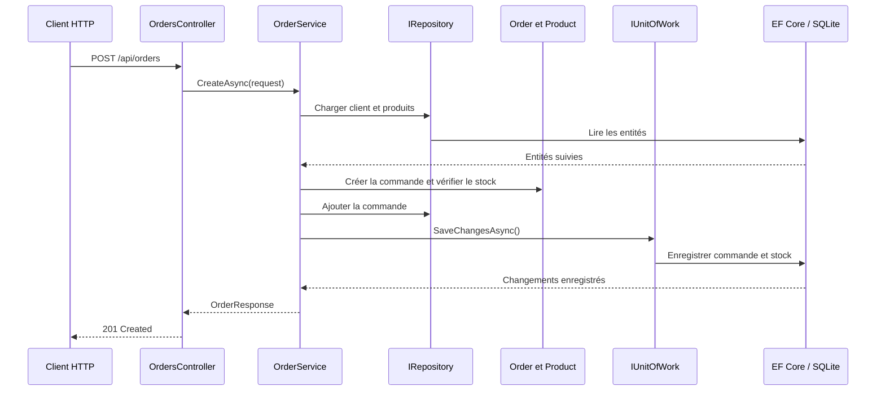

# Architecture de l'application

API e-commerce en .NET 10 organisée en Clean Architecture. Les contrôleurs
appellent directement les services applicatifs : le projet n'utilise ni CQRS
ni MediatR.

## Projets et dépendances

- **Domain** contient les entités, objets-valeurs, règles métier et exceptions.
  Il ne dépend d'aucun autre projet.
- **Application** contient les DTOs, les interfaces de dépôt et les services
  applicatifs. Il dépend du domaine, mais pas des détails techniques.
- **Infrastructure** implémente les interfaces de persistance définies par
  Application et configure EF Core avec SQLite.
- **API** expose les contrôleurs REST et configure l'injection des dépendances.

Les flèches représentent les références de projets. Les interfaces permettent
à Application de demander des opérations de persistance sans référencer
Infrastructure.

## Relations entre les classes métier

### Comment lire le schéma

- `Customer`, `Category`, `Product` et `Order` héritent de `BaseEntity`, qui
  fournit leur identifiant et leur date de création.
- Une catégorie regroupe plusieurs produits. Chaque produit conserve le
  `CategoryId` de sa catégorie.
- Un client peut passer plusieurs commandes. Chaque commande conserve le
  `CustomerId` du client.
- Une commande est composée de lignes `OrderItem`. Chaque ligne contient le
  `ProductId`, la quantité et le prix unitaire appliqué à la commande.
- `Address` décrit l'adresse d'un client ou l'adresse de livraison d'une
  commande.
- `Money` représente un montant et sa devise. Il est utilisé pour le prix du
  produit et celui mémorisé sur une ligne de commande.
- `OrderStatus` indique l'état d'une commande.

Dans le modèle de domaine, `OrderItem` référence un produit par son identifiant
plutôt que par une propriété de navigation. La configuration EF Core établit
la relation persistée vers `Product`.

EF Core configure `Address`, `Money` et la collection `Order.Items` comme des
objets possédés. Leur persistance est ainsi rattachée à l'entité propriétaire.

## Parcours de création d'une commande

Le service d'application orchestre le cas d'utilisation. Les règles telles que
la validation de la quantité disponible sont portées par le domaine. EF Core
enregistre les modifications suivies par le contexte lors de l'appel à
`SaveChangesAsync`.

## Documentation associée

- [Patterns et principes appliqués](DESIGN-PATTERNS.md)
- [README principal](README.md)
